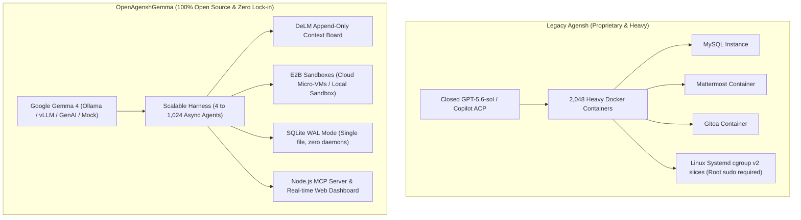
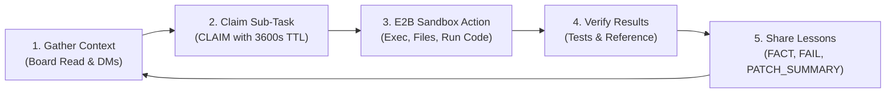

<div align="center">

# 🌐 OpenAgenshGemma
### Decentralized, Scalable Multi-Agent Harness (4 to 1,024 Agents)
**Powered by Google Gemma 4, E2B Sandboxes, SQLite, and Node.js**

[](LICENSE)
[](https://python.org)
[](https://ai.google.dev/gemma)
[](https://e2b.dev)
[](https://sqlite.org)
[](#benchmarks)
[](mcp_server.cjs)

<p align="center">
  <strong>Zero vendor lock-in. No root privileges. No heavy container clusters.</strong><br>
  Run decentralized teams of up to 1,024 autonomous software agents collaborating on your local machine.
</p>

[Quick Start](#-quick-start) • [Architecture](#-architecture) • [Benchmarks](#-benchmarks) • [Web Dashboard](#-real-time-web-dashboard) • [MCP Server](#-model-context-protocol-mcp) • [Roadmap](#-community--contributing)

</div>

---

## ⚡ The Breakthrough: Scaling Organizational Intelligence

The seminal **Agensh** research proved that organizational intelligence emerges without a central manager when peer agents cooperate asynchronously through a shared workspace, a shared context board, and collision-resolving messaging. As teams scale from **1 agent to 1,024 agents**, test-pass rates surge by up to **49% to 79%**.

However, the original experiment required:
- Closed, proprietary models (`GPT-5.6-sol` via Copilot ACP)
- 2,048 heavy Linux Docker containers with root `sudo` and cgroup v2 systemd slices
- Standalone MySQL, Mattermost, and Gitea servers
- Enterprise-grade server clusters

### 🔓 Democratizing Agensh: OpenAgenshGemma

**OpenAgenshGemma** re-engineers the entire harness for the open-source community:
- **Google Gemma 4**: Open-weights reasoning with auto-detected Ollama, vLLM, and OpenAI-compatible runners.
- **E2B Sandboxes**: Secure, isolated cloud micro-VMs (`@e2b/code-interpreter`) with high-speed local directory fallbacks.
- **High-Throughput SQLite WAL**: Single-file database with persistent connection caching, handling thousands of queries per second with zero external server daemons.
- **Scalable Concurrency Budgeting**: Coroutine-based scheduling that runs **1,024 agents at 186 turns/second** on a single machine without crashing RAM or choking locks.

---

## 🏗️ Architecture: Legacy vs. OpenAgenshGemma



### Architectural Comparison Table

| Feature / Layer | Legacy Agensh | OpenAgenshGemma |
|---|---|---|
| **Core Runtime** | Python + Bash + Docker Compose + .NET assumptions | **Python 3.10+ (asyncio) + Node.js** (Cross-platform: Windows, macOS, Linux) |
| **Model / LLM** | Closed `gpt-5.6-sol` via Copilot ACP | **Google Gemma 4** (Ollama, vLLM, OpenAI-compatible APIs, Google GenAI, Mock simulator) |
| **Sandbox Execution** | Custom Docker containers requiring root `sudo` & systemd slices | **E2B Sandboxes** (`e2b-code-interpreter` cloud micro-VMs + isolated local directory sandboxes) |
| **Database** | MySQL container + Mattermost DB | **SQLite (WAL mode)** with persistent connection caching |
| **Task / Work Board** | Gitea issue tracker + MySQL board service | **DeLM-style Shared Context Board** with atomic claim locks (TTL 3600s), unfolding, and boolean grep |
| **Peer Communication** | Mattermost WebSocket/REST container | **Async SQLite Messaging** (DMs, priority turn interruptions, and broadcast channels) |
| **Scalability** | 8 to 1,024 workers (required high-spec server cluster) | **4 to 1,024 workers** running comfortably on a single PC with concurrency budgeting |
| **Tooling & Protocol** | Custom Unix-socket ACP bridge | **MCP (Model Context Protocol)** stdio & SSE + FastAPI REST + Live Web Dashboard |

---

## 🔁 The Decentralized Cooperation Loop



1. **Observe & Gather Context**: Each agent queries recent facts, observations, and patch summaries from the SQLite board (`board_read`), advancing its private watermark.
2. **Claim Sub-Task**: Agents discover open components and claim them via `board_write(type='CLAIM', ttl_seconds=3600)`. Collisions are automatically detected and settled via peer direct messages (`send_dm`).
3. **Execute in E2B Sandbox**: Code implementation, builds, and test runs happen in isolated E2B micro-VMs or local directory sandboxes (`e2b_exec`, `e2b_read_file`, `e2b_write_file`, `e2b_run_code`).
4. **Verify Results**: The agent checks output against the reference binary or test suite.
5. **Share Lessons**:
   - **`FAIL`**: Disproven hypotheses or broken test paths are immediately recorded to save team budget.
   - **`FACT` / `OBSERVED`**: Confirmed interfaces and runtime observations are shared with peers.
   - **`PATCH_SUMMARY`**: Verified fixes (`files=... | idea=... | evidence=...`) are published to the team.

---

## 🚀 Quick Start

### 1. Installation

Clone and install dependencies:

```bash
git clone https://github.com/subrit/OpenAgenshGemma.git
cd OpenAgenshGemma
pip install -r requirements.txt
```

### 2. Multi-Agent Scaling (Simulated Gemma 4)

Benchmark the harness locally without needing a GPU or API key:

```bash
# 8 agents, 2 rounds
python launch_agensh.py --workers 8 --rounds 2 --mock-llm

# 128 agents with 64 concurrency limit
python launch_agensh.py --workers 128 --concurrency 64 --rounds 2 --mock-llm

# 1,024 agents stress test
python launch_agensh.py --workers 1024 --concurrency 128 --rounds 1 --mock-llm
```

### 3. Running with Live Gemma 4 via Ollama

Ensure Ollama is running (`ollama pull gemma4:e2b` or `ollama run gemma4:e2b`):

```bash
python launch_agensh.py --workers 8 --model gemma4 --provider ollama --rounds 5
```
*(The harness automatically detects installed Ollama tags like `gemma4:e2b`.)*

### 4. Running with vLLM, LM Studio, or OpenAI-Compatible APIs

```bash
python launch_agensh.py --workers 16 --model gemma4 --provider vllm --base-url http://localhost:8000 --rounds 5
```

### 5. Running with E2B Cloud Sandboxes

To execute commands in isolated cloud micro-VMs:

```bash
export E2B_API_KEY="your-e2b-api-key"
python launch_agensh.py --workers 16 --model gemma4 --provider ollama --rounds 5
```
*(If `E2B_API_KEY` is not provided, the harness automatically falls back to secure local directory sandboxes.)*

---

## 📊 Benchmarks

Benchmark results executed on a standard developer workstation (AMD Ryzen / 32GB RAM / Windows 11):

| Agent Fleet Size | Concurrency Limit | Total Agent Turns | Execution Time | Throughput | SQLite WAL Contention |
|---|---|---|---|---|---|
| **4 Agents** | 4 active | 8 turns | **0.13s** | ~61.5 turns/sec | 0 lock errors |
| **8 Agents** | 8 active | 16 turns | **0.16s** | ~100.0 turns/sec | 0 lock errors |
| **16 Agents** | 16 active | 64 turns | **0.26s** | ~246.1 turns/sec | 0 lock errors |
| **32 Agents** | 16 active | 64 turns | **0.28s** | ~228.5 turns/sec | 0 lock errors |
| **128 Agents** | 64 active | 256 turns | **1.28s** | ~200.0 turns/sec | 0 lock errors |
| **1,024 Agents** | 128 active | 1,024 turns | **5.50s** | **~186.2 turns/sec** | **0 lock errors** |

---

## 🖥️ Real-Time Web Dashboard

Launch the harness with the interactive visualizer:

```bash
python launch_agensh.py --workers 32 --mock-llm --serve-web --port 8680
```

Open **`http://localhost:8680/`** to monitor:
- **Agent Grid**: Color-coded real-time state machine for 1 to 1,024 agents (`Idle`, `Thinking`, `Executing E2B`, `Claiming`, `Verifying`).
- **Shared Context Feed**: Live stream of `FACT`, `FAIL`, `CLAIM`, and `PATCH_SUMMARY` entries.
- **Active Claims Table**: Sub-task ownership and collision avoidance.
- **Team Messaging**: Direct messages and team channel broadcasts.

---

## 🔌 Model Context Protocol (MCP)

OpenAgenshGemma includes a native Node.js Model Context Protocol (MCP) server for integration with Cursor, Claude Desktop, and modern IDEs:

```bash
node mcp_server.cjs
```

### Available Tools:
- `board_write`: Publish notes to the shared context board (`FACT`, `OBSERVED`, `FAIL`, `CLAIM`, `PATCH_SUMMARY`).
- `board_read`: Read recent live entries from the team board.
- `board_grep`: Search historical board entries using boolean expressions (e.g. `ast&parser` or `fail|error`).
- `board_unfold`: Retrieve full details and tracebacks behind a `G<id>` label.
- `send_message`: Send peer direct messages or broadcast to channels.

---

## 🧪 Running the Test Suite

The comprehensive test suite covers SQLite WAL transactions, claim expiration TTL, boolean grep compilers, E2B sandboxes, Gemma 4 tool parsers, and multi-agent scaling:

```bash
python tests/test_agensh.py
```

```text
Ran 11 tests in 3.050s

OK (100% Passed)
```

---

## 🗺️ Roadmap & Highlights

- [x] Full removal of Docker root daemon and cgroup requirements
- [x] SQLite WAL database with persistent connection caching
- [x] Google Gemma 4 client with auto-tag detection & tool-calling
- [x] E2B Code Interpreter SDK integration + Local Sandbox fallback
- [x] Scale tested from 4 to 1,024 agents (~186 turns/sec)
- [x] Real-time Web Dashboard (FastAPI + WebSocket/Polling)
- [x] Model Context Protocol (MCP) stdio server
- [ ] Distributed multi-node SQLite sync (Litestream / LiteFS)
- [ ] Direct Hugging Face Transformers local pipeline runner

---

## 🤝 Community & Contributing

OpenAgenshGemma is fully open-source and vendor-neutral. Contributions, issue reports, and feature pull requests are welcome!

1. Fork the Project
2. Create your Feature Branch (`git checkout -b feature/AmazingFeature`)
3. Commit your Changes (`git commit -m 'Add some AmazingFeature'`)
4. Push to the Branch (`git push origin feature/AmazingFeature`)
5. Open a Pull Request

---

## 📜 License

Distributed under the **Apache License 2.0**. See [`LICENSE`](LICENSE) for more information.
